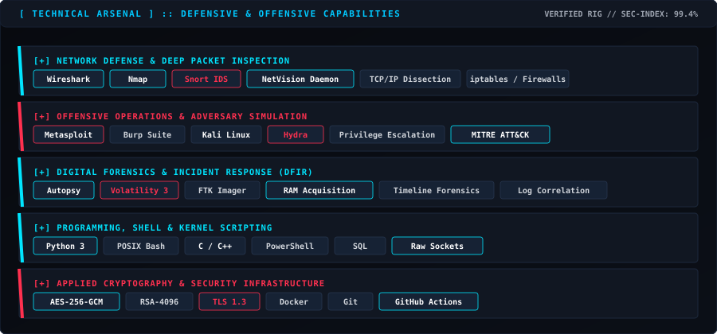
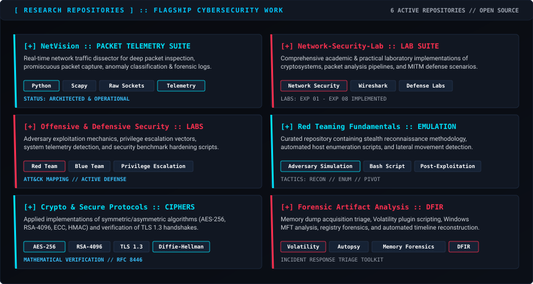
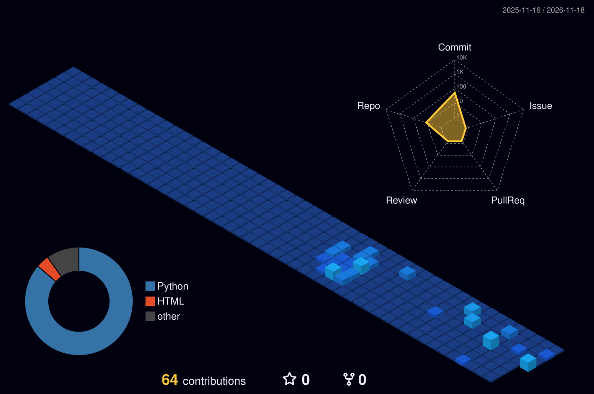
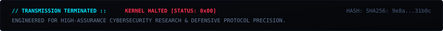

  <!-- ================= 01: CINEMATIC HERO BANNER ================= -->
  

    
  

   

  <!-- ================= 02: VERIFIED COMMUNICATION CHANNELS ================= -->
  

    
    &nbsp;
    
    &nbsp;
    
    &nbsp;
    
    &nbsp;
    
  

   

  <!-- ================= 03: ANIMATED TYPING INTRODUCTION ================= -->
  

    
  

   

  <!-- ================= 04: CLASSIFIED OPERATOR DOSSIER ================= -->
  

    
  

   
  

    
  

   

  <!-- ================= 05: TECHNICAL ARSENAL DASHBOARD ================= -->
  

    
  

   
  

    
  

   

  <!-- ================= 06: FLAGSHIP RESEARCH REPOSITORIES ================= -->
  

    
  

   
  

    
  

   

  <!-- ================= 07: RECONNAISSANCE & CONTRIBUTION MATRIX ================= -->
  

    
  

   

  <!-- ================= 08: 3D RECONNAISSANCE TOPOGRAPHY (COLLAPSIBLE) ================= -->
  

    
<code>[+] VIEW 3D RECONNAISSANCE TOPOGRAPHY (3D GRAPH)</code>

     
    

      
    

  

   

  <!-- ================= 09: RECENT TELEMETRY ACTIVITY WAVEFORM ================= -->
  

    
  

   
  

    
  

   

  <!-- ================= 10: SYSTEM PERFORMANCE & LANGUAGES ================= -->
  <table align="center" border="0" cellspacing="0" cellpadding="0">
    <tr>
      <td align="center" valign="middle">
        
      </td>
      <td align="center" valign="middle">
        
      </td>
    </tr>
  </table>

   

  <!-- ================= 11: STREAK ANALYSIS ================= -->
  

    
  

   

  <!-- ================= 12: FOOTER STATUS ================= -->
  

    
  

