<div align="center">

  <!-- HERO BANNER -->
  <a href="https://github.com/KartikGurung">
    
  </a>

  <br/><br/>

  <!-- QUICK BADGE PILLS -->
  <a href="https://github.com/KartikGurung">
    
  </a>
  <a href="mailto:kartikgurung.cs@gmail.com">
    
  </a>
  <a href="https://github.com/KartikGurung?tab=repositories">
    
  </a>

  <br/><br/>

  <!-- TERMINAL TELEMETRY JSON COMPONENT -->
  

  <br/>
  
  <br/>

</div>

### 📡 `01 // SECURITY DOSSIER & PROFILE OVERVIEW`

```yaml
identity:
  operator: "Kartik Gurung"
  domain: "Cybersecurity & Defensive Engineering"
  degree: "B.Tech Computer Science & Engineering (Specialization in Cybersecurity)"
  clearance_interests:
    - "Digital Forensics & Incident Response (DFIR)"
    - "Network Security Architecture & Protocol Analysis"
    - "Ethical Hacking & Penetration Testing"
    - "Adversary Simulation & Vulnerability Research"
  current_flagship: "NetVision (High-Performance Packet Telemetry & Inspection)"
  motto: "Analyze deep, defend relentlessly, secure by design."
```

---

<div align="center">

### 🌐 `02 // COMMUNICATE & VERIFY CREDENTIALS`

<a href="https://www.linkedin.com/in/kartikgurung/">
  
</a>
<a href="mailto:kartikgurung.cs@gmail.com">
  
</a>
<a href="https://github.com/KartikGurung">
  
</a>
<a href="https://tryhackme.com">
  
</a>
<a href="https://hackthebox.com">
  
</a>

</div>

<br/>

<br/>

### 🛠️ `03 // SECURITY ARSENAL & TECHNICAL STACK`

<table align="center" width="100%">
  <thead>
    <tr>
      <th width="30%" align="left">Sector</th>
      <th width="70%" align="left">Technologies, Tools &amp; Protocols</th>
    </tr>
  </thead>
  <tbody>
    <tr>
      <td><b>🛡️ Network Security &amp; Defense</b></td>
      <td>
        
        
        
        
        
        
      </td>
    </tr>
    <tr>
      <td><b>⚔️ Penetration Testing &amp; Red Teaming</b></td>
      <td>
        
        
        
        
        
        
      </td>
    </tr>
    <tr>
      <td><b>🔬 Digital Forensics &amp; DFIR</b></td>
      <td>
        
        
        
        
        
      </td>
    </tr>
    <tr>
      <td><b>💻 Programming &amp; Scripting</b></td>
      <td>
        
        
        
        
        
      </td>
    </tr>
    <tr>
      <td><b>⚙️ Systems &amp; Environment</b></td>
      <td>
        
        
        
        
        
      </td>
    </tr>
  </tbody>
</table>

<br/>

<br/>

### 🎯 `04 // FEATURED SECURITY PROJECTS & RESEARCH`

<table align="center" width="100%">
  <tr>
    <td width="50%" valign="top">
      <h4><a href="https://github.com/KartikGurung/NetVision"><code>🛰️ NetVision</code></a></h4>
      <p><b>Real-Time Network Traffic Analyzer &amp; Packet Telemetry Suite</b></p>
      <p>Modular network analysis tool architected for deep packet inspection (DPI), live protocol dissection, traffic anomaly classification, and exportable forensics logs.</p>
      <p>
        <code>Python</code> • <code>Scapy</code> • <code>Packet Dissection</code> • <code>Network Telemetry</code>
      </p>
    </td>
    <td width="50%" valign="top">
      <h4><a href="https://github.com/KartikGurung/Network-Security-Lab"><code>🛡️ Network-Security-Lab</code></a></h4>
      <p><b>Comprehensive Network Security Laboratory &amp; Implementations</b></p>
      <p>Rigorous, reproducible experimental suite implementing cryptosystems (AES, RSA, ECC), packet sniffing pipelines, firewall policy rulesets, and MITM defense scenarios.</p>
      <p>
        <code>Network Security</code> • <code>Wireshark</code> • <code>Cryptography</code> • <code>Defense Labs</code>
      </p>
    </td>
  </tr>
  <tr>
    <td width="50%" valign="top">
      <h4><a href="https://github.com/KartikGurung/OffensiveAndDefensiveSecurity"><code>⚔️ Offensive &amp; Defensive Security</code></a></h4>
      <p><b>Red Teaming Playbooks &amp; Hardening Strategies</b></p>
      <p>Hands-on exploitation frameworks, privilege escalation labs, endpoint telemetry detection, and security benchmark hardening scripts for UNIX and Windows environments.</p>
      <p>
        <code>Red Team</code> • <code>Privilege Escalation</code> • <code>Mitre ATT&amp;CK</code> • <code>Hardening</code>
      </p>
    </td>
    <td width="50%" valign="top">
      <h4><a href="https://github.com/KartikGurung/Red-Teaming-Fundamentals"><code>🎯 Red Teaming Fundamentals</code></a></h4>
      <p><b>Adversary Emulation &amp; Post-Exploitation Mechanics</b></p>
      <p>Curated repository containing stealth reconnaissance methodology, automated host enumeration scripts, and lateral movement detection mechanisms.</p>
      <p>
        <code>Adversary Simulation</code> • <code>Bash Scripting</code> • <code>Post-Exploitation</code>
      </p>
    </td>
  </tr>
  <tr>
    <td width="50%" valign="top">
      <h4><a href="https://github.com/KartikGurung/Crypto-Secure-Protocols"><code>🔐 Cryptography &amp; Secure Protocols</code></a></h4>
      <p><b>Cryptographic Primitives &amp; Handshake Verification</b></p>
      <p>Implementation of modern symmetric/asymmetric cryptographic algorithms, digital signatures, hashing algorithms, and verification of TLS 1.3 handshake mechanics.</p>
      <p>
        <code>AES-256</code> • <code>RSA-4096</code> • <code>SHA-3</code> • <code>TLS 1.3</code> • <code>Diffie-Hellman</code>
      </p>
    </td>
    <td width="50%" valign="top">
      <h4><a href="https://github.com/KartikGurung/Forensic-Artifact-Analysis"><code>🔍 Forensic Artifact Analysis</code></a></h4>
      <p><b>Digital Forensics &amp; Incident Response Investigation</b></p>
      <p>Toolkit for memory dump extraction, Volatility plugin scripting, Windows MFT analysis, browser artifact reconstruction, and automated timeline generation.</p>
      <p>
        <code>Volatility</code> • <code>Autopsy</code> • <code>Memory Forensics</code> • <code>DFIR</code>
      </p>
    </td>
  </tr>
</table>

<br/>

<br/>

### 🐍 `05 // CONTRIBUTION MATRIX & TELEMETRY STREAM`

<div align="center">

  <!-- SNAKE CONTRIBUTION GRAPH -->
  <!-- Automatically updated via .github/workflows/snake.yml -->
  <picture>
    <source media="(prefers-color-scheme: dark)" srcset="https://raw.githubusercontent.com/KartikGurung/KartikGurung/output/github-contribution-grid-snake-dark.svg">
    <source media="(prefers-color-scheme: light)" srcset="https://raw.githubusercontent.com/KartikGurung/KartikGurung/output/github-contribution-grid-snake.svg">
    
  </picture>

  <br/><br/>

  <!-- ACTIVITY GRAPH -->
  

</div>

<br/>

<br/>

### 📊 `06 // GITHUB METRICS & PERFORMANCE TELEMETRY`

<div align="center">

  <table align="center" border="0" cellspacing="0" cellpadding="0">
    <tr>
      <td align="center" valign="middle">
        <a href="https://github.com/KartikGurung">
          
        </a>
      </td>
      <td align="center" valign="middle">
        <a href="https://github.com/KartikGurung">
          
        </a>
      </td>
    </tr>
  </table>

  <br/>

  <!-- GITHUB STREAK STATS -->
  <a href="https://github.com/KartikGurung">
    
  </a>

  <br/><br/>

  <!-- TROPHY SHOWCASE (COLLAPSIBLE TO AVOID OVERCROWDING) -->
  <details>
    <summary><b>🏆 VIEW GITHUB ACHIEVEMENTS &amp; TROPHIES</b> (Click to Expand)</summary>
    <br/>
    <a href="https://github.com/KartikGurung">
      
    </a>
  </details>

</div>

<br/>

<br/>

<div align="center">
  <p>
    <code>⚡ TRANSMISSION TERMINATED // ROOT@SECURITY-CORE:~$ EXIT 0 ⚡</code>
  </p>
  <p>
    <i>Crafted with an uncompromising focus on defensive precision &amp; high-assurance cybersecurity.</i>
  </p>
</div>

