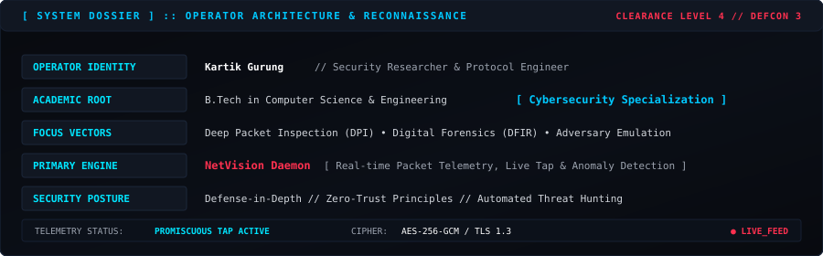
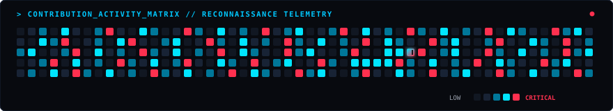

  <!-- 01: CINEMATIC HERO BANNER -->
  

    

  <!-- 02: VERIFIED COMMUNICATION MATRIX -->
  
  
  
  
  

    

  <!-- 03: ANIMATED TYPING INTRODUCTION -->
  

    

  <!-- 04: CLASSIFIED OPERATOR DOSSIER -->
  

   
  
   

  <!-- 05: TECHNICAL ARSENAL DASHBOARD -->
  

   
  
   

  <!-- 06: FLAGSHIP RESEARCH REPOSITORIES -->
  

   
  
   

  <!-- 07: RECONNAISSANCE MATRIX & CONTRIBUTION STREAM -->
  <picture>
    <source media="(prefers-color-scheme: dark)" srcset="https://raw.githubusercontent.com/KartikGurung/KartikGurung/output/github-contribution-grid-snake-dark.svg">
    <source media="(prefers-color-scheme: light)" srcset="https://raw.githubusercontent.com/KartikGurung/KartikGurung/output/github-contribution-grid-snake.svg">
    
  </picture>

    

  <!-- 08: TELEMETRY ACTIVITY WAVEFORM -->
  

   
  
   

  <!-- 09: PERFORMANCE & LANGUAGE RATIOS -->
  <table align="center" border="0" cellspacing="0" cellpadding="0">
    <tr>
      <td align="center" valign="middle">
        
      </td>
      <td align="center" valign="middle">
        
      </td>
    </tr>
  </table>

   

  <!-- 10: STREAK ANALYSIS -->
  

    

  <!-- 11: FOOTER STATUS -->
  

